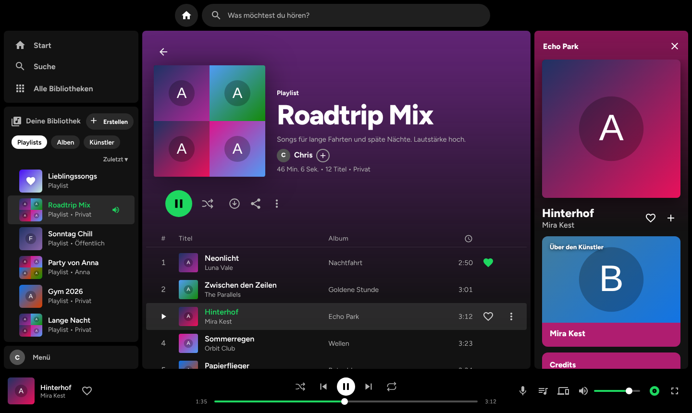
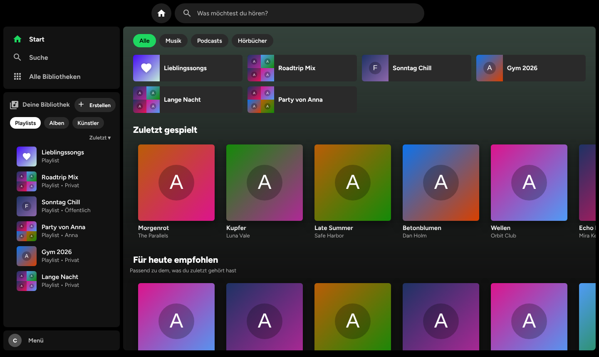
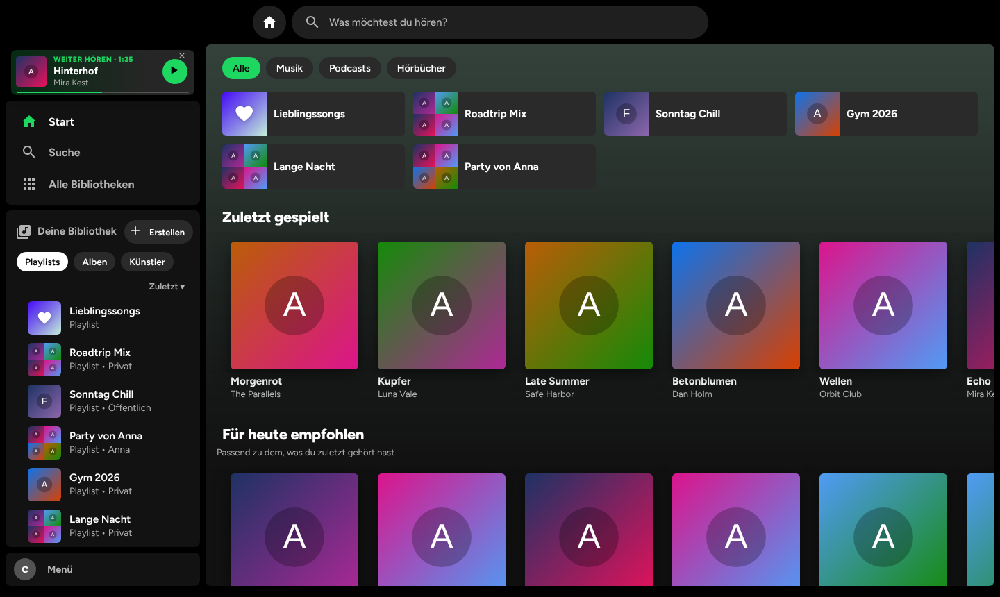
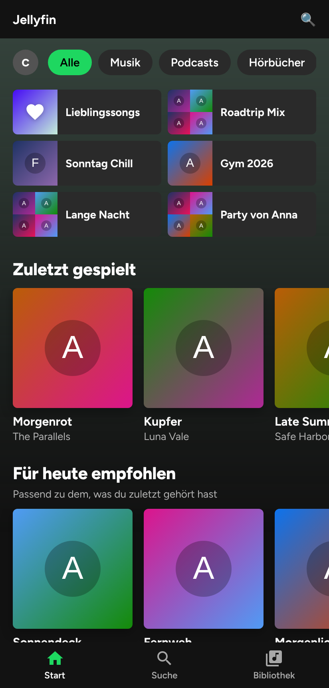
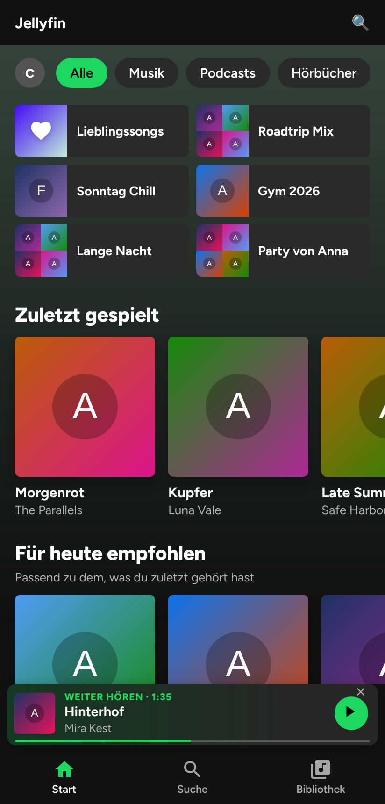
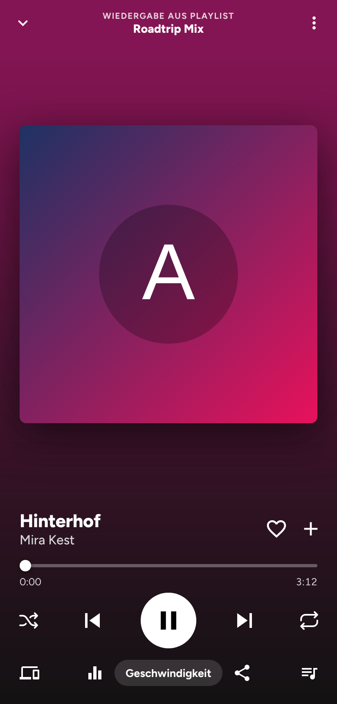

# Music Look – Spotify-Look für Jellyfin 12

**Music Look** ist ein Jellyfin-Plugin (nur Jellyfin 12.x), das die Musik-Bibliothek deines Servers wie **Spotify** aussehen und sich so bedienen lässt – in der Web-Oberfläche, in der offiziellen Android-App und am Computer mit Seitenleiste, Kopfleiste mit Suche und Player-Leiste. Dazu: **Spotify-Playlists nach Jellyfin importieren**, Mixe, smarte Playlists, Genres, Statistik, Songtexte, Equalizer, Offline-Downloads, Teilen, Jam und **„Weiter hören“ auf jedem Gerät**.

*English:* Music Look is a Jellyfin 12 plugin that turns your Jellyfin music library into a Spotify-style app (web, Android app, desktop layout). It imports Spotify playlists, builds mixes and smart playlists, shows lyrics, has an equalizer, offline downloads, playlist sharing, "Jam" sessions and a server-side "continue listening" that works across devices. Alles Weitere unten auf Deutsch.

[Installieren](#installieren) · [Funktionen](#funktionen) · [Spotify-Playlist importieren](#spotify-playlist-importieren) · [Fragen und Antworten](#fragen-und-antworten) · [Änderungen](CHANGELOG.md) · [Fehler melden](https://github.com/Chris-coder-lab/jellyfin-plugin-musiclook/issues/new/choose)

## So sieht es aus
*Beispieldaten aus der Testumgebung des Projekts (erfundene Titel, Platzhalter-Cover) – auf deinem Server siehst du deine eigene Musik und deine echten Cover.*

  

| Start (Computer) | Weiter hören (Computer) |
| --- | --- |
|  |  |

| Handy: Start | Handy: Weiter hören | Handy: Player |
| --- | --- | --- |
|  |  |  |

## Auf einen Blick
- **Spotify-Look** für Handy, Tablet und Computer (ab 900 px Breite mit Seitenleiste, Kopfleiste und Player-Leiste), Start · Suche · Bibliothek, Chips Alle · Musik · Podcasts · Hörbücher.
- **Weiter hören:** Was läuft (samt Playlist, Position, Hörbuch-Kapitel), merkt sich dein Jellyfin-Konto auf dem Server. App geschlossen, anderes Gerät – die Leiste ganz oben bringt dich mit einem Tipp zurück an die Stelle.
- **Spotify-Playlists importieren** (Link, Titel-Links, Spotify-Datenexport, CSV oder Liste), danach aktualisierbar.
- **Mixe, smarte Playlists, Genres, Statistik, Ähnliche Künstler, Einschlaf-Timer, M3U-Export/-Import.**
- **Player** mit Songtext (LRC/TXT), Warteschlange, Geräte-Wechsel, Geschwindigkeit, **10-Band-Equalizer**.
- **Playlists teilen**, Cover und Beschreibung für alle Benutzer, **Jam** (gemeinsame Warteschlange).
- **Downloads und Offline-Modus** direkt in der Jellyfin-Oberfläche (keine zusätzliche App).
- **Podcasts und Hörbücher** getrennt von der Musik, mit eigenen Abschnitten und Fortschritt.

Alles Spotify-Ähnliche ist **nachgebaut für den eigenen Server** – das Plugin ist nicht von Spotify, es greift nur auf deine eigenen Musikdateien zu und kopiert keine Spotify-Inhalte (beim Import wird nur die Titelliste mit deiner Bibliothek abgeglichen).

## Neu in 2.0.2
- **Weiter hören überarbeitet:** Die Karte oben auf der Startseite ist weg. Die Leiste sitzt jetzt dort, wo sonst der Player ist – am Computer ganz oben in der Seitenleiste (über Start und Suche), am Handy direkt über der unteren Leiste –, als hättest du die App nur kurz geschlossen.
- **Zuverlässiger starten:** Eine einzige Tippfläche (Leiste und Play-Knopf sind dasselbe). Während des Startens ist die Leiste gesperrt und zeigt „wird gestartet …“ (kein doppelter Start bei schnellem Mehrfachtippen). Das Plugin wartet, bis die App nach dem Öffnen für Fernsteuerung bereit ist, prüft, dass der Titel wirklich läuft, wiederholt bis zu dreimal und spult nach, falls die Startposition ignoriert wurde. Klappt es nicht, bleibt die Leiste stehen und meldet es, statt zu verschwinden.
- Beim Zurückkehren in die App wird der gemerkte Stand frisch vom Server geholt (z. B. wenn du zwischendurch auf einem anderen Gerät gehört hast).

## Neu in 2.0.1
- **Alle Bibliotheken (Computer):** Die versteckte Spotify-Ansicht blieb am Computer sichtbar stehen, weil eine Anzeige-Regel das „versteckt" überstimmte. Jetzt verschwindet sie wirklich.
- **Bibliothek links:** Alben und Künstler laden beim Scrollen automatisch nach (100 pro Seite), nicht mehr nur die ersten 60.
- **Weiter hören:** Ist im gespeicherten Stand nur der laufende Titel bekannt, bleibt die gemerkte Warteschlange erhalten bzw. wird die Playlist/das Album neu geladen – danach läuft es mit dem nächsten Titel weiter.
- **Podcasts und Hörbücher:** Startseite mit Abschnitten (Zuletzt gehört mit Fortschritt, Neueste Folgen / Neu hinzugefügt, Autoren und Sprecher, Alle als Raster). Ein Tipp setzt beim zuletzt gehörten Kapitel an der gemerkten Position fort.

## Neu in 2.0
- **Weiter hören (serverseitig):** Was gerade läuft (Titel, Playlist, Album, Mix, Hörbuch, Podcast-Folge – samt Position) wird in den Anzeige-Einstellungen deines Jellyfin-Kontos gespeichert. Schließt du die App oder wechselst das Gerät, zeigt Music Look die Leiste **Weiter hören**; ein Tipp setzt genau dort fort. Beim Schließen der Seite wird zusätzlich ein letzter Stand per `sendBeacon` gesendet (Best Effort, der Normalfall ist das Speichern alle 20 s und bei jedem Titel-/Pausenwechsel).
- **Computer-Ansicht wie Spotify:** Kopfleiste mit Home-Knopf und zentrierter Suche, in der Bibliothek der Knopf **Erstellen** und die Sortierung **Zuletzt / A–Z**, Chips Playlists · Alben · Künstler.
- **Alle Bibliotheken:** Der Knopf in der Seitenleiste führt jetzt zuverlässig zur normalen Jellyfin-Startseite (Verlassen mit Fallback; reicht der normale Seitenwechsel nicht, wird die Seite einmal neu geladen).
- **Genres:** Ansicht „Genres“ mit allen Musikrichtungen deiner Bibliothek, je Genre Titel abspielen/mischen.
- **Smarte Playlists:** Regeln (Genres, Erscheinungsjahre, Status: ungehört · Lieblingssongs · schon gehört) speichern; die Liste füllt sich beim Öffnen automatisch neu. Pro Konto gespeichert, auf jedem Gerät verfügbar.
- **Statistik:** Meistgespielte Titel, Hörzeit, Wiedergaben – aus den Wiedergabezählern von Jellyfin für dein Konto.
- **Ähnliche Künstler** auf der Künstlerseite (über Jellyfins `Artists/{id}/Similar`).
- **Einschlaf-Timer** im Player.
- **M3U-Export/-Import** für Playlists.
- **Jellyfin-12-Fix:** Anfragen mit `api_key` im Link (Cover, Download, sendBeacon) laufen nur noch mit dem Parameter `ApiKey`, den Jellyfin 12 noch akzeptiert (die alten Zugriffswege sind dort abgeschaltet).
- Verbesserter Spotify-Abgleich (Titel-Normalisierung, Duplikate), manuelle Zuordnungen gelten für alle Playlists, entfernte Titel und Reihenfolge werden bei Aktualisierungen beachtet.

## Wie findet man das Plugin?
- Dashboard → Plugins → Repositories → Repository-Link (siehe „Installieren“) → im Katalog **Music Look**.
- Auf GitHub: `Chris-coder-lab/jellyfin-plugin-musiclook`.

## Voraussetzungen
- Jellyfin 12.0 oder neuer (getestet gegen den Quellcode von 12.0 und 12.2)
- Kein weiteres Plugin nötig: Das Plugin fügt sein Script selbst in die Startseite der Web-Oberfläche ein.
- Funktioniert in der Web-Oberfläche und in der offiziellen Android-App (Web-Wrapper). Nicht in Swiftfin, Findroid oder nativen TV-Apps: Die Oberfläche ist eine Erweiterung der Web-Oberfläche, native Apps laden sie nicht. Swiftfin selbst ist laut seiner Dokumentation ein Videoclient ohne Unterstützung für Musik und Playlists. Das Plugin verändert nichts an den API-Antworten, die Swiftfin nutzt (Filme, Serien usw.); Geräte, die laut Server keine Musik abspielen können, werden in der Geräteauswahl nicht angeboten.

## Bauen und veröffentlichen
1. Ordner als GitHub-Repository `jellyfin-plugin-musiclook` hochladen.
2. Neuen Tag mit **vier** Zahlen setzen und pushen, z. B. `git tag v2.0.2.0 && git push origin v2.0.2.0`.
3. Der Workflow baut die ZIP, legt das Release an und trägt die neue Version selbst in `manifest.json` ein (Bot-Commit auf `main`). Vor dem nächsten Tag deshalb `git pull` ausführen.

## Installieren
Jellyfin → Dashboard → Plugins → Repositories → neues Repository:
`https://raw.githubusercontent.com/Chris-coder-lab/jellyfin-plugin-musiclook/main/manifest.json`

Dann im Katalog Music Look installieren, Jellyfin neu starten und die Web-Oberfläche mit Strg+F5 neu laden (in der Android-App: App-Daten/Cache leeren).

## Funktionen
**Wo das Plugin aktiv ist:** nur auf der Startseite einer Musik-Bibliothek (`#/music`) sowie auf den Seiten von Playlists und Alben. Dort ersetzt eine Overlay-Ansicht die Standardseite; über „Klassische Ansicht“ im Profilmenü (Avatar oben links) kommst du zur Standard-Ansicht (und mit dem grünen Knopf „Spotify-Ansicht“ unten rechts wieder zurück). Die klassische Ansicht gilt nur bis zum Neustart der App bzw. des Tabs.

**Startseite (mobil wie Spotify):**
- Oben Profilbild und Chips **Alle · Musik · Podcasts · Hörbücher**.
- Schnellzugriff (Lieblingssongs + deine ersten Playlists), darunter die Reihen **Deine Playlists** (mit „Neue Playlist“), **Mit dir geteilt**, **Zuletzt gespielt**, **Neu hinzugefügt**.
- Untere Leiste **Start · Suche · Bibliothek**, darüber der Mini-Player.
- **Podcasts / Hörbücher:** Das sind Bibliotheken, deren *Name* eines der Stichwörter aus den Plugin-Einstellungen enthält (Standard: `podcast,predigt` bzw. `hörbuch,hörbücher,audiobook,hörspiel`; Umlaute werden gleich behandelt). Gibt es keine solche Bibliothek, erklärt der Chip das.
- **Suche:** ohne Suchbegriff **alle Titel der Musikbibliothek in einer alphabetischen Liste** (mit Abspielen und Zufall, 100 pro Seite, „Mehr laden“); mit Suchbegriff Treffer für Titel, Alben, Künstler und Playlists. **Bibliothek:** Playlists, Alben, Künstler.
- Die Standard-Bedienelemente von Jellyfin in Musikbibliotheken (Alben/Play/Zufall/Filter, A–Z-Leiste, Kachel-/Listenansicht, Seitenpfeile, „1–100 von 407“) werden dort ausgeblendet; außerhalb von Musik und in der klassischen Ansicht bleiben sie unverändert.

**Playlist-Seite:**
- Cover oben: dein eigenes Bild, sonst ein Platzhalter aus vier Alben-Covern der enthaltenen Titel. Darunter Name, Beschreibung, Besitzer mit Profilbild und „+“ (Personen hinzufügen), Laufzeit (z. B. „7 Std. 32 Min.“), Titelanzahl, Privat/Öffentlich.
- Aktionen: Herunterladen, Teilen, Drei-Punkte-Menü, Zufall, Abspielen.
- Drei-Punkte-Menü: Teilen, Zu dieser Playlist hinzufügen, Playlist bearbeiten (Titel nach oben/unten schieben, entfernen), Name und Details (Name, Beschreibung, Cover), Cover ändern, Playlist löschen (löscht **nie** die Titel selbst), Herunterladen, Zur Warteschlange hinzufügen, Zu einer anderen Playlist hinzufügen, Mitwirkende einladen, Jam starten, Auf privat/öffentlich umstellen. Bei Playlists anderer Personen statt Löschen: „Aus meiner Bibliothek entfernen“.
- Jeder Titel (auch in Alben): kleines Cover links statt Nummer, Titel groß, Künstler darunter, rechts Menü: Teilen, Zu Playlist hinzufügen, Aus Lieblingssongs, Aus dieser Playlist entfernen, Zur Warteschlange, Album anzeigen, Künstler*in aufrufen, Geschwindigkeit ändern, Jam starten, Zum Song-Radio, Songinfos.

**Player (wie Spotify):** Mini-Player (Farbe passt sich dem Cover an, zeigt bei Fremdgeräten „Auf <Gerät>“) und Titelseite mit großem Cover, Titel, Künstler, Herz, **„+“ (zu Playlist hinzufügen)**, Fortschrittsleiste, Zufall, Zurück/Pause/Weiter, Wiederholen, Geräte, Geschwindigkeit, Teilen, Warteschlange. Alle Farben der Seite folgen dynamisch dem Cover. Scrollst du nach unten, siehst du Karten für **Songtext**, **Als Nächstes aus der Warteschlange**, **Über den Künstler** (Beschreibung aus Jellyfin) und **Credits** (Interpret, Komponist, Texter, Album, Jahr, Genre, Songinfos); oben bleibt dann eine **kompakte Leiste mit Titel, Künstler und Pause/Weiter**.

**Equalizer (Menü und Knopf in der Titelseite):** 10 Bänder (31 Hz bis 16 kHz, ±12 dB), Voreinstellungen **Flach, Musik, Predigt, Hörbuch, Bass, Höhen**, dazu **De-Esser** und **automatische Rauschunterdrückung** als Schalter. Alles wird im Browser per Web Audio berechnet, nicht auf dem Server. Änderungen sind nach dem Loslassen sofort hörbar; mit **Übernehmen** werden sie gespeichert, mit **Abbrechen** (oder Esc) verworfen, **Zurücksetzen** stellt Flach und alles aus ein. Er wirkt nur auf Musik, die in diesem Browser abgespielt wird. Auf iPhone und iPad ist er im Browser abgeschaltet, weil Jellyfin dort Web Audio selbst meidet (es stört Tempo und Tonhöhe). Ohne Equalizer-Einstellung wird das Audio-Element nicht angefasst.

**Songtext ohne Whisper:** Der Songtext kommt aus Jellyfins eigener Songtext-Funktion. Jellyfin liest Dateien mit **exakt demselben Namen wie die Musikdatei** und der Endung `.lrc` (synchron, Zeile wird mitgeführt) oder `.txt` (unsynchron), die im selben Ordner liegen, zum Beispiel `Luna Vale - Neonlicht.mp3` und `Luna Vale - Neonlicht.lrc`. Der Eingangsordner-Sortierer verschiebt diese Dateien jetzt mit der MP3 und benennt sie passend um. Ohne passende Datei zeigt die Karte einen Hinweis; es wird nie geraten oder automatisch aus dem Internet geladen.

**Gerätewechsel:** Das Geräte-Symbol (Mini-Player und Titelseite) listet alle Jellyfin-Sitzungen **deines** Kontos, die sich fernsteuern lassen (z. B. Laptop im Browser, anderes Handy). Antippen überträgt Warteschlange und Position dorthin und stoppt das aktuelle Gerät. Darin auch die Lautstärke. Den internen Lautsprecher oder Bluetooth-Geräte des Handys stellt das Betriebssystem ein; das kann eine Web-Seite nicht übernehmen.

**Playlists pro Benutzer, teilbar:** Playlists gehören dem jeweiligen Benutzer (so speichert Jellyfin sie). Der Besitzer kann sie mit einzelnen Benutzern teilen (lesen oder mitbearbeiten) – über das „+“ neben seinem Namen oder im Teilen-Menü. Neue Playlists sind privat. Ausgeblendete und deaktivierte Konten werden nicht angeboten.

**Cover und Beschreibung für alle Benutzer:** Jellyfin erlaubt das Setzen von Bild und Beschreibung sonst nur Administratoren. Das Plugin stellt dafür eigene Endpunkte bereit, die für den Besitzer (und Mitbearbeiter) der Playlist gelten.

**Herunterladen:** Packt die Titel einer Playlist als ZIP und lädt sie auf das Gerät (nur Titel, die der Benutzer herunterladen darf). In der offiziellen Android-App wird dafür deren Download-Funktion genutzt, im Browser der normale Download.

**Jam:** Gemeinsame Warteschlange. Jemand startet einen Jam und bekommt einen 6-stelligen Code, andere treten bei und hängen Titel hinten an. Reihenfolge ist für alle gleich. Sitzungen liegen nur im Arbeitsspeicher und enden nach 6 Stunden ohne Aktivität oder beim Neustart von Jellyfin.

**Look in der klassischen Ansicht:** Abgerundete Karten, Reiter als Chips, Wischen zwischen Reitern, Plus-Button bei Titeln/Alben/Künstlern, Schrift Figtree (vom Plugin selbst ausgeliefert), Akzentfarbe einstellbar.

**Künstlerseite:** Antippen eines Künstlers öffnet eine eigene Seite (schwarzer Hintergrund) mit Beliebten Titeln, Alben, Abspielen und Zufall.

**Hintergrund:** Im Musik-Bereich wird das Hintergrundbild des Jellyfin-Themes („purple haze“) vollständig entfernt, damit nichts mehr durchscheint.

**Computer-Ansicht (ab 900 px Fensterbreite):** links die Bibliothek mit Chips (Playlists · Alben · Künstler) und „+“ für neue Playlists, in der Mitte der Inhalt mit Farbverlauf und Titeltabelle (Nummer/Abspielen, Titel, Album, Dauer, Herz, Menü), rechts die Ansicht des laufenden Titels (Cover, Künstlerkarte), unten die Player-Leiste (Titel, Zufall, Zurück, Pause, Weiter, Wiederholen, Fortschritt, Lautstärke, Geräte, Warteschlange, Vollbild). Unter 900 px bleibt es die Handy-Ansicht. Das Profilmenü (unten links „Menü“) enthält zusätzlich Dashboard und Einstellungen.

**Zurück-Taste:** Titelansicht, Warteschlange, Menüs und Dialoge sind eigene Schritte im Browserverlauf. „Zurück“ (auch die Zurück-Geste auf dem Handy) schließt zuerst sie und führt nie ungewollt zur Jellyfin-Startseite; der Pfeil in Playlists führt zur vorherigen Seite der App.

**Teilen:** „Link kopieren“ erzeugt eine Adresse der Web-Oberfläche (`…/web/index.html#/details?id=…`) auf Basis der Serveradresse oder der Einstellung „Link-Adresse für Teilen“. WhatsApp macht aber nur Adressen mit echtem Domainnamen anklickbar (`https://musik.beispiel.de/…`), keine IP-Adressen wie `192.168.…` oder `localhost`; bei solchen Adressen zeigt der Dialog einen Hinweis.

**Mixe, Sender, Mixtapes und Autoplay:** Sie bleiben bei einer Stilrichtung. Das Plugin liest einmal (und dann alle 30 Minuten) die Titel der Musikbibliothek samt Genres, deine Playlists, Lieblingssongs und die zuletzt gehörten Titel und bewertet jeden Titel nach Ähnlichkeit zum Ausgangstitel bzw. Künstler: seltene Genres zählen mehr als sehr häufige, dazu gleiche Künstler und Alben, Künstler und Titel, die in deinen Playlists oder in einer Hörsitzung zusammenstehen, und das Erscheinungsjahr. Zu unähnliche Titel kommen nicht in den Mix, je Künstler gibt es eine Obergrenze. Die Berechnung läuft im Browser; bei einer sehr kleinen Bibliothek (unter 25 Titel) oder einem Fehler gilt Jellyfins Sofortmix. Wie gut die Mixe sind, hängt von den Genre-Angaben und Playlists deiner Bibliothek ab: ohne Genres und ohne Playlists bleibt nur die Ähnlichkeit über Künstler, Alben und Jahr.

**Schnell beim Öffnen:** Playlists, Bibliotheken und Playlist-Cover werden im Browser gemerkt und sofort angezeigt, der Server aktualisiert sie im Hintergrund (wichtig bei laufendem Bibliotheksscan). Bekannte Musik-Seiten werden schon beim Laden abgedeckt, damit das alte Jellyfin-Layout nicht kurz aufblitzt.

## Spotify-Playlist importieren
Menü (Profilbild) → **Von Spotify importieren** oder im Dialog „Neue Playlist“.
1. **Playlist-Link einfügen** (in Spotify: Teilen → Link kopieren). Das liefert Name, Beschreibung, Cover und die ersten 100 Titel – mehr zeigt Spotify über den Link nicht (auch nicht im Browser-Einbettungsfeld). Hat die Playlist mehr Titel, weist die Vorschau darauf hin und bietet **Weitere Titel ergänzen** an. Dafür gibt es drei Wege, die sich beliebig kombinieren lassen (schon vorhandene Titel werden nicht doppelt aufgenommen):
   - **Titel-Links einfügen:** in Spotify die Playlist öffnen, alle Titel markieren (Strg+A), kopieren (Strg+C) und im Feld einfügen. Der Server liest dann jeden Titel einzeln bei Spotify (höchstens drei gleichzeitig, mit Fortschrittsanzeige und Abbrechen; bei vielen Titeln kann das dauern). Liefert Spotify gar nichts, bricht das Lesen früh mit einem Hinweis ab.
   - **Spotify-Datenexport (JSON):** über die Spotify-Kontoseite die Funktion „Deine Daten herunterladen“ nutzen und die Playlist-Daten anfordern (das kann dauern). Die Datei `Playlist1.json` einfach laden; enthält sie mehrere Playlists, wählst du eine aus.
   - **CSV-Datei** (z. B. von Exportify, Spalten Track URI / Track Name / Artist Name(s) / Album Name / Duration) oder eine einfache **Titelliste** („Titel – Künstler“ oder „Künstler – Titel“, die Richtung wird erkannt).
2. Die Vorschau zeigt, welche Titel in deiner Bibliothek gefunden wurden (**gefunden**, **ähnlich** mit dem gefundenen Titel, **nicht verfügbar**). Einzelne Treffer lassen sich abwählen; Name und Beschreibung sind änderbar; das Cover wird übernommen, wenn du es lässt.
3. **Playlist erstellen** legt die Playlist aus den gefundenen Titeln an und merkt sich die **Quelle** (alle Spotify-Titel, auch die fehlenden, samt Link) auf dem Server, damit sie von jedem Gerät aus aktualisiert werden kann. **Tabelle (CSV)** speichert die Liste für Excel.

**Playlist aktualisieren:** Unter den Titeln einer importierten Playlist steht der Abschnitt **Spotify-Abgleich** (Anzahl fehlender Titel, aufklappbar mit der Liste).
- **Jetzt aktualisieren** lädt die Bibliothek neu, liest den Spotify-Link erneut (neue Titel am Anfang der Spotify-Liste kommen dazu), gleicht alle noch fehlenden Titel ab und zeigt die neuen Treffer zum Auswählen. „Hinzufügen“ hängt sie an die Playlist an; Titel, die du bewusst abwählst, werden nicht mehr vorgeschlagen. Titel, die du aus der Jellyfin-Playlist gelöscht hast, kommen nicht wieder.
- **Weitere Titel ergänzen** nimmt neue Titel aus Titel-Links, Datei oder Liste dazu (wie beim Import).
- **Automatisch aktualisieren** (Schalter je Playlist): Beim Öffnen von Music Look wird höchstens einmal am Tag geprüft; sichere Treffer kommen dann von selbst in die Playlist (mit Hinweis). Das läuft im Browser, nicht als Serverdienst: Es passiert also nur, wenn du Music Look öffnest.
- Aufgeräumt wird von selbst: Die gemerkte Quelle einer gelöschten Playlist wird vom Server entfernt, ältere lokal gemerkte Listen (bis Version 1.4) werden beim ersten Öffnen übernommen bzw. bei gelöschten Playlists entfernt.

Grenzen: Der Link-Weg und das Lesen einzelner Titel nutzen die öffentlichen Einbettungsseiten von Spotify über den Jellyfin-Server. Das ist keine offizielle Spotify-Schnittstelle: Spotify kann den Aufbau jederzeit ändern oder Anfragen drosseln, und der Server muss `open.spotify.com` und die Bildserver von Spotify erreichen können. Die offizielle Spotify-Schnittstelle liefert Titel nur für eigene oder mitbearbeitete Playlists und verlangt eine eigene Spotify-App (und für deren Besitzer Premium), daher wird sie nicht verwendet.

## Musik, Podcasts und Hörbücher bleiben getrennt
Die Reiter **Musik**, **Podcasts** und **Hörbücher** zeigen nur Inhalte aus ihren eigenen Bibliotheken; nur **Alle** mischt.
- **Suche:** hat dieselben Reiter wie die Startseite (der Reiter gilt für beide). In „Musik“ werden nur Musik-Bibliotheken durchsucht, in „Podcasts“ nur Podcast-, in „Hörbücher“ nur Hörbuch-Bibliotheken; in „Alle“ wird wie bisher alles durchsucht. Playlists erscheinen in „Alle“ und „Musik“.
- **Empfehlungen, Mixe, Sender, Mixtapes, „Zuletzt gespielt“, „Neu hinzugefügt“, Bibliothek:** nur Musik. Lieblingssongs: im Reiter „Musik“ nur Musik, im Reiter „Alle“ auch Favoriten aus Podcasts und Hörbüchern.
- **Autoplay und Song-Radio:** nach einer Podcast-Folge oder einem Hörbuch-Kapitel wird keine Musik angehängt; zu Folgen und Kapiteln gibt es kein Song-Radio. Jellyfins Sofortmix (Rückfall bei kleinen Bibliotheken) wird auf Musik gefiltert.
- Welche Bibliothek zu welchem Reiter gehört, bestimmen wie bisher die Stichwörter in den Plugin-Einstellungen (Podcast-/Hörbuch-Bibliotheken nach Namen). Liegen Podcasts oder Hörbücher in derselben Bibliothek wie die Musik, kann das Plugin sie nicht trennen.

## Downloads und Musik vom Gerät (alles in der Jellyfin-Oberfläche)
Es wird **keine zusätzliche App** installiert. Downloads, Verwaltung und Abspielen vom Gerät laufen in der Spotify-Ansicht innerhalb der normalen Jellyfin-App bzw. Jellyfin-Weboberfläche.
- **Herunterladen:** Bei Playlists, Alben, Lieblingssongs und Mixen gibt es einen Download-Knopf (Kreis mit Pfeil). Grün gefüllt heißt: alles ist auf dem Gerät. Einzelne Titel lädst du über das Drei-Punkte-Menü des Titels. Geladene Titel tragen ein grünes Symbol. Ändert sich eine geladene Playlist, zieht der Download beim nächsten Öffnen nach.
- **Wohin:** Die Dateien liegen im Browser-Speicher (IndexedDB) des Geräts, nicht auf dem Server. Auf dem Server wird nichts verändert.
- **Menü „Downloads und Speicher“** (Profilbild-Menü): belegter Platz der Downloads, Schätzung des freien Platzes des Browsers, laufende Downloads mit Abbruch, geladene Listen und Einzeltitel mit Löschen, „Alle Downloads löschen“, Qualität (Original oder platzsparend als MP3 mit 192 kbit/s, vom Server umgerechnet) und die Möglichkeit, dauerhaften Speicher anzufordern.
- **Vom Gerät abspielen:** Auf der Downloads-Seite (Alle abspielen, Zufall, Abspielen-Knopf je Liste und Titel) und im Menü einer vollständig geladenen Liste („Vom Gerät abspielen“). Es erscheint **derselbe Player wie online** (Leiste, Vollansicht, Warteschlange, Weiter/Zurück, Zufall, Wiederholen, „Wiedergabe aus Playlist“ mit Namen, Songtext). Der Ton kommt aus dem Gerätespeicher, der Server wird dafür nicht gebraucht.
- **Offline-Modus:** Fällt die Verbindung zum Server aus (auch bei aktivem VPN ohne Internet; die App prüft den Server alle paar Sekunden), wechselt die Spotify-Ansicht selbst in den Offline-Modus: oben ein Offline-Zeichen, Startseite, Bibliothek, Suche, Playlists, Alben, Lieblingssongs und Mixe zeigen nur Heruntergeladenes im gewohnten Aussehen. Von Hand lässt er sich im Profil-Menü und auf der Seite „Downloads und Speicher“ ein- und ausschalten.
- **Songtext:** Wird beim Herunterladen mitgespeichert. Die Karte „Songtext“ hat einen Vergrößern-Knopf; die große Ansicht (wie bei Spotify) zeigt die Zeilen groß, hebt die aktuelle hervor und spult beim Antippen einer Zeile.
- **Grenzen:**
  - **Die Jellyfin-Seite selbst braucht den Server zum Starten.** Jellyfins Web-Oberfläche speichert sich nicht für den Offlinebetrieb (ihr Service Worker kümmert sich laut Quellcode nur um Benachrichtigungen). Das Plugin kann das nicht ändern, ohne Jellyfins eigenen Service Worker zu ersetzen; das wäre ein zu tiefer Eingriff in Jellyfin. Die lokale Wiedergabe funktioniert darum, solange die Seite einmal geladen ist (Verbindung bricht ab, schwaches Netz, Datensparen, Funkloch nach dem Laden). Ein Neustart der App komplett ohne Verbindung zum Server ist nicht möglich.
  - Die Steuerung über den Sperrbildschirm zeigt beim lokalen Abspielen Titel und Cover und reagiert auf Pause/Weiter/Zurück. Jellyfin bindet seine eigenen Tasten nur einmal; das Plugin ersetzt sie durch Tasten, die bei Serverwiedergabe an dieselbe Sitzung weiterleiten.
  - Der Speicherplatz hängt vom Browser und Gerät ab. Safari löscht Daten einer Website nach 7 Tagen ohne Nutzung (außer für Apps auf dem Startbildschirm); „Dauerhaft speichern“ ist dort nicht garantiert. Jede Datei wird beim Laden kurz komplett im Arbeitsspeicher gehalten (sehr große Hörbuch-Dateien belasten Handys). Formate, die das Gerät nicht abspielen kann, lädt das Plugin automatisch als MP3.

## Grenzen
- **Nicht umgesetzt, weil Jellyfin dafür nichts bietet:** „Zu Video wechseln“ und „Playlist/Titel aus dem Geschmacksprofil ausschließen“ (dafür gibt es in Jellyfin keine Entsprechung).
- **Zwei Arten von Download:** Das Menü einer Playlist bietet weiter den ZIP-Download (Dateien für eine beliebige Musik-App). Der Download-Knopf lädt dagegen in den Browser-Speicher des Geräts, um die Titel direkt in der Jellyfin-Oberfläche vom Gerät abzuspielen (siehe oben). Die Seite selbst startet ohne Server nicht; laut Jellyfin-Forum hat auch die offizielle Android-App keinen Offline-Modus (Findroid als Fremd-App kann heruntergeladene Titel offline abspielen).
- Jam synchronisiert die Warteschlange, nicht die Wiedergabeposition: Pause und Spulen sind pro Gerät.
- Nicht umgesetzt: Hörerzahlen pro Monat bei Künstlern (Jellyfin kennt sie nicht), Umschalten zwischen Lautsprecher und Bluetooth (Sache des Betriebssystems).
- Der Player folgt der Wiedergabe des Web-Clients auf dem eigenen Gerät und zeigt, wenn dort nichts läuft, automatisch ein anderes Gerät desselben Benutzers, auf dem Musik läuft (Steuern klappt nur, wenn dessen App Fernsteuerung unterstützt). Die grün markierte Playlist wird aus der Warteschlange erkannt: Sie gilt nur, wenn die Warteschlange genau die Titel der Playlist enthält (nicht mehr, sobald Titel zur Warteschlange hinzugefügt oder entfernt wurden; Zufallsreihenfolge stört nicht); die Position wird alle paar Sekunden abgeglichen.
- Playlist-Cover aus Titeln werden im Browser aus Alben-Covern zusammengesetzt; ein hochgeladenes Bild wird als JPEG bis 800 × 800 gespeichert.
- Jellyfin 12.2 bringt bereits einen „Zur Playlist hinzufügen“-Knopf und einen Öffentlich/Privat-Schalter mit; die klassische Ansicht ergänzt das um den Plus-Button an Karten und das Teilen mit einzelnen Benutzern.
- Pause, Spulen und Lautstärke wirken sofort nur auf diesem Gerät; Weiter, Zurück, Zufall und Wiederholen laufen weiter über Jellyfins Sitzungs-Schnittstelle.
- Das Plugin ist gegen den Quellcode von Jellyfin 12.0/12.2 und im Browser mit einer nachgebauten Seite geprüft (mehrere hundert automatische Prüfungen im Browser, dazu Tests des Sortierers), nicht in einer laufenden Jellyfin-12-Installation.

## Sicherheit
- Jam-Endpunkte nur für angemeldete Benutzer, Mitgliedschaft wird pro Anfrage geprüft.
- Jam speichert nur Titel-IDs (keine Titel). Beim Hinzufügen wird geprüft, dass der Benutzer den Titel sehen darf. Codes aus 6 zufälligen Zeichen, Begrenzung bei Fehlversuchen.
- Das Script sendet nichts nach außen; die Schrift kommt vom eigenen Server.
- Playlist-Endpunkte prüfen pro Anfrage, ob der Benutzer die Playlist sehen bzw. bearbeiten darf; Cover-Upload nur als JPEG bis 2,5 MB, Beschreibung bis 500 Zeichen.
- Der ZIP-Download enthält nur Titel, die der Benutzer sehen und herunterladen darf. Für den Download aus dem Browser wird das Anmelde-Token in der Adresse mitgegeben (wie bei Jellyfins eigenem Download-Link).

## Fragen und Antworten
**Muss ich etwas zusätzlich installieren?** Nein. Das Plugin fügt sein Script selbst in die Web-Oberfläche ein. Nach der Installation Jellyfin neu starten und die Seite mit Strg+F5 neu laden (Android-App: App-Daten/Cache leeren).

**Wo erscheint die Spotify-Ansicht?** Auf der Startseite einer Musik-Bibliothek sowie auf den Seiten von Playlists und Alben. Über „Alle Bibliotheken“ (Computer: Seitenleiste) oder „Klassische Ansicht“ im Profilmenü kommst du zur normalen Jellyfin-Oberfläche.

**Funktioniert es in Swiftfin, Findroid oder der TV-App?** Nein. Music Look erweitert die Web-Oberfläche; native Apps laden sie nicht.

**Was passiert mit „Weiter hören“, wenn ich das Gerät wechsle?** Der Stand liegt in den Anzeige-Einstellungen deines Jellyfin-Kontos auf dem Server. Das Speichern geschieht alle 20 Sekunden und bei jedem Titel-/Pausenwechsel; beim Schließen der Seite wird zusätzlich ein letzter Stand gesendet (Best Effort – ob das auf deinem Gerät klappt, hängt vom Browser bzw. der App ab).

**Werden Daten an Spotify oder andere Dienste gesendet?** Das Script sendet nichts an Dritte. Der Spotify-Import liest die öffentlichen Einbettungsseiten von Spotify über deinen Jellyfin-Server, nur um die Titelliste abzugleichen. Das ist keine offizielle Schnittstelle und kann sich jederzeit ändern.

**Was ist getestet?** Das Plugin ist gegen den Quellcode von Jellyfin 12.0/12.2 und in einem Browser mit einer nachgebauten Seite (viele automatische Prüfungen, siehe unten bei „Grenzen“) geprüft. Auf einem echten Server kann es noch Abweichungen geben – bitte melde sie als [Issue](https://github.com/Chris-coder-lab/jellyfin-plugin-musiclook/issues/new/choose) mit Jellyfin-Version, Browser/App und einer kurzen Beschreibung.

**Wie kann ich helfen?** Fehler melden, Wünsche äußern oder das Projekt mit einem Stern markieren. Hinweise zum Mitmachen stehen in [CONTRIBUTING.md](CONTRIBUTING.md).

## Lizenzen
Die Schrift Figtree steht unter der SIL Open Font License 1.1 (`FONT-LICENSE-OFL.txt`). Die Symbole der App-Ansicht sind nach den Material Design Icons von Google gezeichnet (Apache License 2.0, https://github.com/google/material-design-icons).
